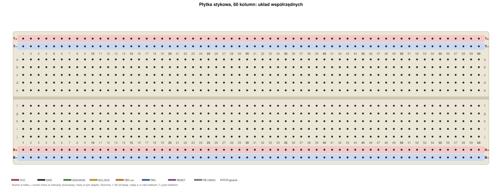
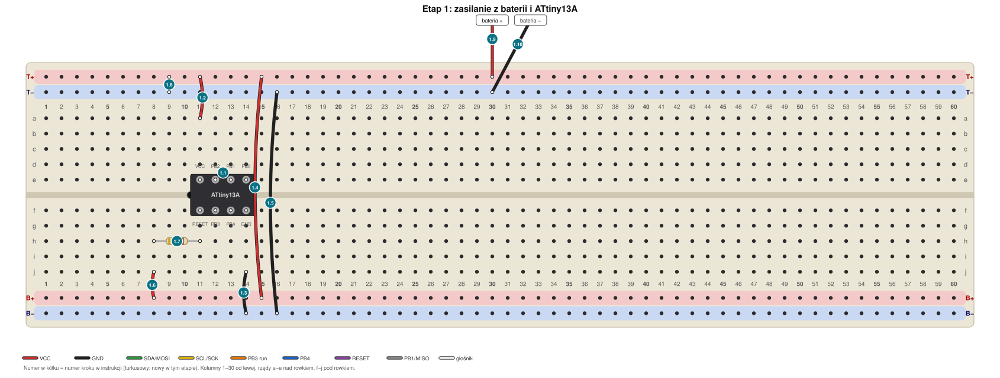
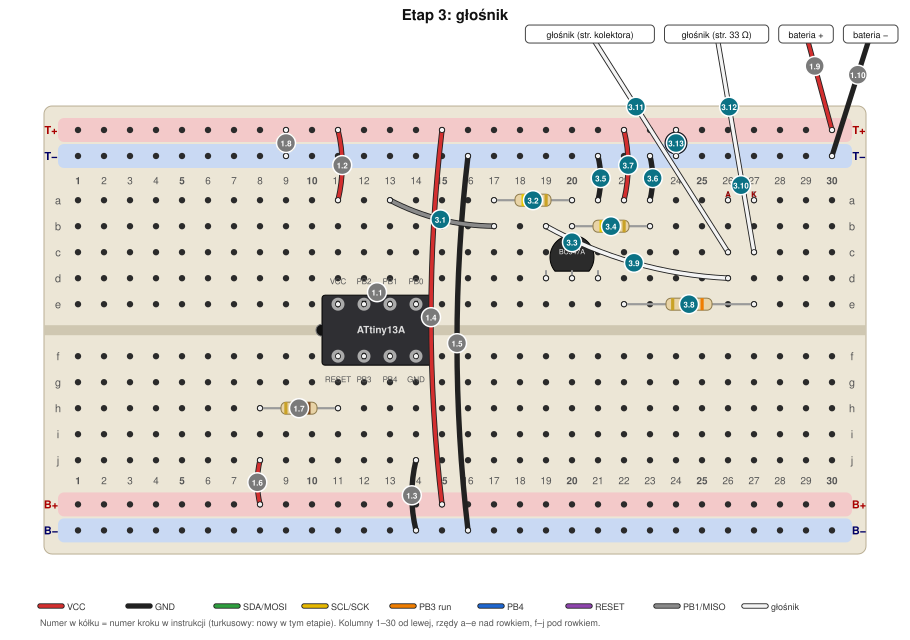
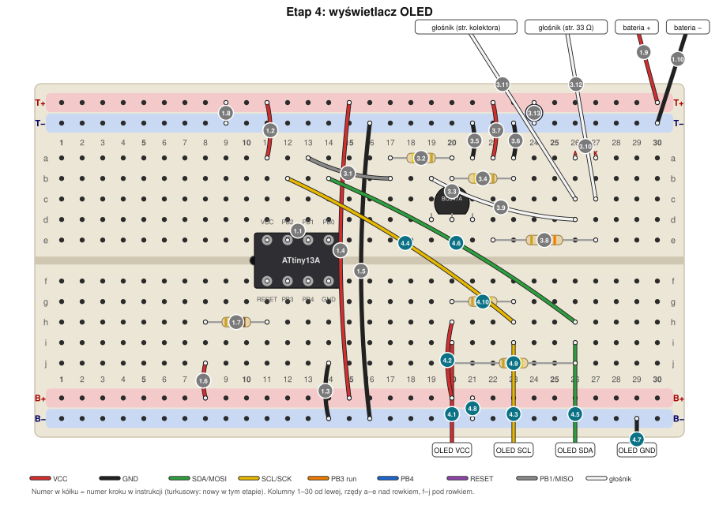
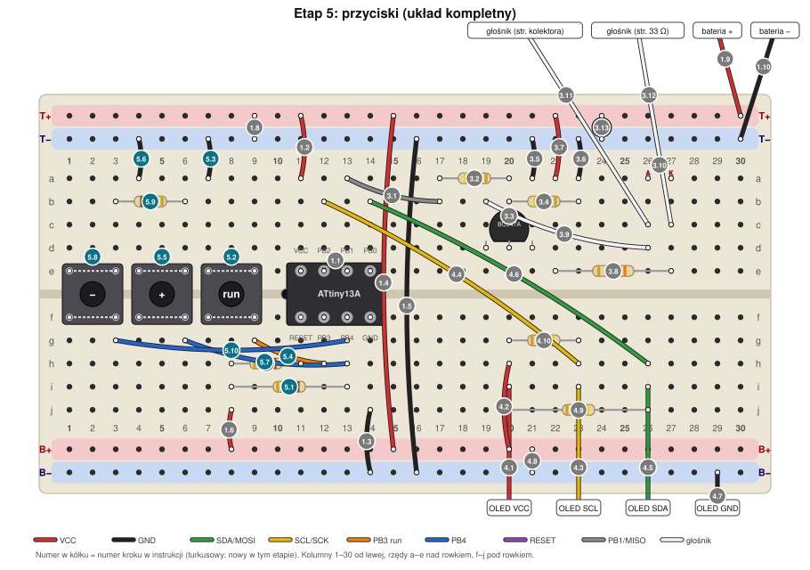

# Minutnik ATtiny13A: instrukcja montażu na płytce stykowej

*Plik wygenerowany skryptem `tools/breadboard/manual.py` z tych samych danych, z których powstały rysunki i weryfikacja sieci połączeń (`tools/breadboard/design.py`). Nie edytuj go ręcznie.*

## Jak korzystać z instrukcji

1. Pracuj etapami. **Każdy etap kończy się sprawdzeniem** (multimetrem lub testem na urządzeniu). Następny etap zaczynaj dopiero po wyniku „działa”. Dzięki temu błąd da się zlokalizować.
2. Każdy krok to jedna czynność z adresem otworu. Odhaczaj pola `[ ]`.
3. Rysunki (katalog `img/`) pokazują płytkę z góry **po** danym etapie. Numer w kółku to numer kroku, turkusowy = nowy w tym etapie.
4. **Programowanie ATtiny odbywa się poza układem**: wyjmujesz go z płytki stykowej, wkładasz do swojej płytki programatora (gniazdo DIP-8), programujesz i wkładasz z powrotem. Na płytce stykowej nie ma więc żadnych przewodów programatora. Opisuje to [programowanie.md](programowanie.md); etap 2 (fuse'y) jest tam.

## Układ współrzędnych



- **Kolumny** numerowane od lewej: 1 … 30. Pięć otworów jednej kolumny po jednej stronie rowka jest połączonych ze sobą.
- **Rzędy**: a–e leżą nad rowkiem środkowym, f–j pod nim. Adres otworu to rząd i kolumna, np. **e11** (rząd e, kolumna 11). Kolumna w górnej połowie (a–e) **nie jest** połączona z tą samą kolumną w dolnej (f–j).
- **Szyny zasilania** (poziome linie, każda połączona na całej długości). W tej instrukcji mają stałe nazwy, **niezależnie od kolorowych nadruków na płytce** (nadruki bywają różne):
  - **T+** = górna szyna zewnętrzna (przy krawędzi płytki), plus;
  - **T−** = górna szyna wewnętrzna (bliżej rzędu a), minus;
  - **B+** = dolna szyna wewnętrzna (bliżej rzędu j), plus;
  - **B−** = dolna szyna zewnętrzna (przy krawędzi), minus.
  - Adres szyny zawiera numer kolumny, przy której leży otwór, np. **T+11** = otwór szyny T+ na wysokości kolumny 11.
- Układ mieści się w 30 kolumnach. Wszystkie kolumny podane w krokach są liczone od lewej strony płytki.
- **Przed zaczęciem sprawdź ciągłość szyn**: multimetr na piszczenie, jedna sonda przy kolumnie 1, druga przy kolumnie 30 tej samej szyny. Jeśli szyna jest przerwana w środku (zdarza się w dłuższych płytkach), połącz obie połówki przewodem.
- Orientacja: płytka leży przed Tobą, rząd a jest **dalej** od Ciebie (u góry rysunku), rząd j **bliżej**.

### Kolory przewodów (stałe w całej instrukcji)

| Kolor | Sygnał |
| --- | --- |
| czerwony | VCC (plus zasilania) |
| czarny | GND (masa) |
| zielony | SDA (PB0, pin 5) |
| żółty | SCL (PB2, pin 7) |
| pomarańczowy | przycisk „run” (PB3, pin 2) |
| niebieski | przyciski „+” i „−” (PB4, pin 3) |
| szary | PB1 (pin 6) |
| biały | głośnik i kolektor tranzystora |

## Lista zakupów i elementów

| Element | Ilość | Wartość / uwagi | Oznaczenia na schemacie |
| --- | --- | --- | --- |
| ATtiny13A, obudowa DIP-8 | 1 | DIP-8 (nie SOIC-8) | U1 |
| Rezystor 15 kΩ | 1 | brązowy-zielony-pomarańczowy; zmierz multimetrem przed włożeniem | R1 |
| Rezystor 8,2 kΩ | 2 | szary-czerwony-czerwony; zmierz multimetrem przed włożeniem | R5, R6 |
| Rezystor 470 Ω | 1 | żółty-fioletowy-brązowy; zmierz multimetrem przed włożeniem | R2 |
| Rezystor 47 kΩ | 1 | żółty-fioletowy-pomarańczowy; zmierz multimetrem przed włożeniem | R3 |
| Rezystor 33 Ω | 1 | pomarańczowy-pomarańczowy-czarny; ½ W; zmierz multimetrem przed włożeniem | R4 |
| Rezystor 4,7 kΩ | 2 (opcjonalnie) | żółty-fioletowy-czerwony; tylko jeśli moduł OLED nie ma pull-upów | R7, R8 |
| Kondensator ceramiczny 100 nF („104”) | 2 | bez polaryzacji | C1, C2 |
| Kondensator elektrolityczny 100 µF, min. 10 V | 1 | **polaryzacja**: długa nóżka = plus | C3 |
| Tranzystor BC547A | 1 | wyprowadzenia C-B-E | Q1 |
| Dioda LED, dowolna | 1 | **polaryzacja**: długa nóżka = anoda | D1 |
| Przycisk tact (4 nóżki) | 3 | „run”, „+”, „−” | S1, S2, S3 |
| Głośnik 6,4 Ω z zabawki | 1 | dwa przewody do przedłużenia | SPK |
| Moduł OLED 128×32, SSD1306, I2C, 4 piny | 1 | adres 0x3C | OLED |
| Koszyk 3×AAA z przewodami | 1 | 4,5 V | BAT |
| Płytka programatora ISP (UNO z ArduinoISP, gniazdo DIP-8, kondensator 10 µF) | 1 | Twoja, gotowa; ATtiny wkładasz do gniazda i programujesz poza układem | |
| Płytka stykowa 400 otworów (30 kolumn) | 1 | szyny po obu stronach | |

**Przewody połączeniowe** (liczby z tej instrukcji):

| Kolor | Ilość | Znaczenie |
| --- | --- | --- |
| czerwony | 7 | VCC (plus) |
| czarny | 8 | GND (minus) |
| zielony | 2 | SDA (PB0) |
| żółty | 2 | SCL (PB2) |
| pomarańczowy | 1 | PB3 („run”) |
| niebieski | 2 | PB4 (przyciski „+” i „−”) |
| fioletowy | 0 | RESET (nieużywany) |
| szary | 1 | PB1 |
| biały | 3 | głośnik i kolektor |

Dwa długie przewody (czerwony i czarny, ok. 10 cm) łączą górne i dolne szyny; do wtyków OLED potrzebne są 4 przewody żeńsko-męskie.

> **Uwaga do briefu i zamiana wartości:** brief zakłada „2× 10 kΩ”, a układ ma trzy rezystory tej klasy (R1 RESET, R5 pull-up PB4, R6 przycisk „−”). Nie masz 10 kΩ, więc użyto: **R1 = 15 kΩ** (wartość nie jest krytyczna), **R5 = R6 = 8,2 kΩ** (muszą być jednakowe: napięcie przy „−” to R6/(R5+R6) = 50% VCC, odczyt ADC ok. 128). Jeśli Twoje „8 kΩ” ma inne paski niż szary-czerwony-czerwony, zmierz je multimetrem: dopuszczalne są 7,5–9,1 kΩ, byle R5 i R6 były jednakowe. Rezystory 4,7 kΩ (R7, R8) potrzebne są tylko, gdy moduł OLED nie ma pull-upów.

## Etap 0: przygotowanie (bez wkładania czegokolwiek w płytkę)

### 0.1 Rezystory: zmierz każdy przed wsadzeniem

Multimetr na zakres Ω. Odczyt powinien być w granicach tolerancji (±5%) wartości z tabeli. Zapisz odczyty.

| Rezystor | Kod kolorów | Odczyt |
| --- | --- | --- |
| 15 kΩ R1 | brązowy-zielony-pomarańczowy | ______ |
| 8,2 kΩ R5, R6 (2 szt., jednakowe) | szary-czerwony-czerwony | ______ |
| 470 Ω R2 | żółty-fioletowy-brązowy | ______ |
| 47 kΩ R3 | żółty-fioletowy-pomarańczowy | ______ |
| 33 Ω R4, ½ W | pomarańczowy-pomarańczowy-czarny | ______ |
| 4,7 kΩ R7, R8 (opcjonalnie) | żółty-fioletowy-czerwony | ______ |

### 0.2 Przyciski: orientacja styków (multimetr na piszczenie)

Przycisk tact ma 4 nóżki. W typowym przycisku nóżki po tej samej stronie są połączone na stałe, a wciśnięcie łączy obie pary.

1. Sprawdzaj piszczeniem kolejne pary nóżek **bez** wciskania przycisku, aż znajdziesz dwie pary, które piszczą (to połączenia stałe w środku przycisku).
2. Sprawdź, że nóżki z **różnych** par nie piszczą, dopóki nie wciśniesz przycisku; po wciśnięciu piszczą wszystkie.
3. Włóż przycisk tak, aby **każda para leżała po jednej stronie rowka** (a nie w poprzek rowka). Gdyby para leżała w poprzek, przycisk zwierałby rowek na stałe.
4. Przycisk „łapie” rowek środkowy: dwie nóżki w rzędzie e, dwie w rzędzie f, w kolumnach odległych o 2.

### 0.3 Moduł OLED

- Przeczytaj nadruk przy 4 pinach modułu. **VCC i GND mają różną kolejność w różnych modułach** (np. GND-VCC-SCL-SDA albo VCC-GND-SCL-SDA). Instrukcja nie zakłada żadnej kolejności: każdy przewód łączysz z pinem o odpowiedniej **nazwie**.
- Zapisz, co jest na module: ______ ______ ______ ______ (pin 1 … pin 4).
- Zmierz pull-upy (zasilanie odłączone): multimetr Ω, jedna sonda na pinie VCC modułu, druga kolejno na SDA i SCL. Odczyt **4,7–10 kΩ** = moduł ma pull-upy (nie montuj R7 i R8). Odczyt „OL” / nieskończoność = brak pull-upów: zamontuj R7 i R8 (krok w etapie 4).

### 0.4 Tranzystor BC547A

Trzymaj tranzystor **płaską stroną do siebie, nóżkami w dół**: od lewej **C – B – E** (kolektor, baza, emiter). Sprawdź nadruk BC547A na obudowie. Wyprowadzenia innych tranzystorów (np. 2N2222 w metalowej obudowie) są inne.

### 0.5 ATtiny13A

Układ ma być w obudowie **DIP-8** (dwa rzędy po 4 nóżki), pasującej do rowka płytki. Jeśli masz SOIC-8 (płaska, płaskie nóżki) — **zatrzymaj się i napisz**: potrzebny będzie adapter.
Pin 1 jest przy wcięciu (lub kropce) na obudowie. Wcięcie ma być po **lewej** stronie.

### 0.6 Głośnik

Do dwóch wyprowadzeń głośnika dolutuj odcinki drutu (lub przewody połączeniowe) tak, aby dały się włożyć w otwory płytki; połączenia zaizoluj taśmą. Jeśli nie lutujesz: mocne skręcenie z końcówką przewodu męskiego i taśma. Głośnik nie ma polaryzacji.

### Ostrzeżenia (obowiązują cały czas)

- **Przed wyjęciem lub włożeniem ATtiny odłącz baterię** (wyjmij czerwony przewód z T+30). Nigdy nie wkładaj jej do płytki stykowej i do gniazda programatora jednocześnie (to dwa źródła zasilania).
- ATtiny wyjmuj równo, najlepiej wyciągaczem do układów DIP lub małym śrubokrętem z obu stron po kolei; krzywo wyjęty układ gnie nóżki. Wkładając sprawdź **wcięcie po lewej**.
- Elektrolity i LED mają polaryzację: odwrotne włożenie może je uszkodzić.
- Zero zwarć: po każdym etapie sprawdź piszczeniem, że plus nie jest połączony z minusem.

## Etap 1: zasilanie i ATtiny13A

**Cel:** ATtiny13A zasilany z baterii, szyny i podciągnięcie RESET gotowe.

**Zanim zaczniesz:** zaprogramuj ATtiny **poza płytką stykową** (patrz [programowanie.md](programowanie.md), sekcje 3 i 4: odczyt sygnatury 0x1E 0x90 0x07 i fuse'y = Etap 2). Układ włóż do płytki stykowej dopiero potem. Baterii na razie nie wkładaj do koszyka.



- [ ] **1.1** **ATtiny13A** w rowek środkowy, wcięcie (kropka przy pinie 1) po **lewej** stronie: pin 1 → **f11**, pin 2 → **f12**, pin 3 → **f13**, pin 4 → **f14**, pin 5 → **e14**, pin 6 → **e13**, pin 7 → **e12**, pin 8 → **e11**. Dociśnij równo, nie zginając nóżek.
- [ ] **1.2** Przewód **czerwony**: z **a11** do **T+11**. — VCC układu (pin 8) na szynę plus.
- [ ] **1.3** Przewód **czarny**: z **j14** do **B−14**. — GND układu (pin 4) na szynę minus.
- [ ] **1.4** Przewód **czerwony**: z **T+15** do **B+15**. — łączy górną i dolną szynę plus (długi przewód).
- [ ] **1.5** Przewód **czarny**: z **T−16** do **B−16**. — łączy górną i dolną szynę minus (długi przewód).
- [ ] **1.6** Przewód **czerwony**: z **j8** do **B+8**. — plus na dolny pasek w kolumnie 8.
- [ ] **1.7** Rezystor **15 kΩ** (brązowy-zielony-pomarańczowy) R1: nóżki w **h11** i **h8**. — RESET (pin 1) przez 15 kΩ do plusa.
- [ ] **1.8** Kondensator ceramiczny **100 nF** (oznaczenie „104”) C1, bez polaryzacji: nóżki w **T+9** i **T−9**. — odsprzęganie zasilania ATtiny.
- [ ] **1.9** **Czerwony** przewód koszyka baterii (plus): koniec w **T+30**. — plus koszyka 3×AAA; baterię wpinaj dopiero po sprawdzeniu zwarć.
- [ ] **1.10** **Czarny** przewód koszyka baterii (minus): koniec w **T−30**. — minus koszyka 3×AAA.

**Sprawdzenie (bateria odłączona, multimetr na piszczenie):**

- [ ] **T+9** ↔ **T−9**: **NIE piszczy** (między szynami plus i minus nie może być zwarcia)
- [ ] **d11** ↔ **T+9**: **piszczy** (pin 8 ATtiny jest połączony z plusem)
- [ ] **i14** ↔ **T−9**: **piszczy** (pin 4 ATtiny ma połączenie z minusem górnej szyny)
- [ ] **T+9** ↔ **B+9**: **piszczy** (szyny plus są połączone długim czerwonym przewodem)
- [ ] **T−9** ↔ **B−9**: **piszczy** (szyny minus są połączone długim czarnym przewodem)
- [ ] **i8** ↔ **T+9**: **piszczy** (dolny pasek plusa w kolumnie 8 jest połączony z plusem)
- [ ] **g11** ↔ **T+9**: rezystancja ≈ 15 kΩ (pin 1 (RESET) przez R1 do plusa; układ scalony może obniżyć odczyt)
- [ ] **g11** ↔ **T−9**: **NIE piszczy** (RESET nie jest zwarty z masą)
- [ ] **T+30** ↔ **d11**: **piszczy** (plus baterii dochodzi do pinu 8 ATtiny)
- [ ] **T−30** ↔ **i14**: **piszczy** (minus baterii dochodzi do pinu 4 ATtiny)

**Sprawdzenie napięcia (włóż baterie do koszyka):**

- [ ] Napięcie koszyka (wolne wyprowadzenia): **4,5–4,8 V**.
- [ ] Między **T+9** a **T−9**: **4,5–4,8 V**.
- [ ] Między **d11** (pin 8) a **i14** (pin 4): **4,5–4,8 V**.
- [ ] Między **g11** (pin 1, RESET) a **T−9**: **ok. 4,5 V** (pull-up R1).

**Gdy wynik jest inny:** brak napięcia → sprawdź przewody baterii (1.9 i 1.10) oraz długie przewody łączące górne i dolne szyny (1.4 i 1.5); plus zwarty z minusem → wyjmij baterię i szukaj zwarcia (dotykające się końcówki przewodów, nóżki kondensatora); napięcie na RESET znacznie niższe niż 4,5 V → R1 w złych otworach lub zwarcie RESET z masą.

**Test przejścia:** brak zwarć, napięcia jak wyżej. Odczyt sygnatury ATtiny robisz w gnieździe programatora (przed włożeniem do płytki).

**Zdjęcie kontrolne #1:** po etapie 1 zrób zdjęcie płytki z góry (cała płytka w kadrze, rzędy i kolumny czytelne) i porównaj z rysunkiem Etapu 1. Zwróć uwagę: wcięcie ATtiny po lewej, pin 1 w f11, czerwony przewód w a11.

## Etap 2: fuse'y

Bez zmian na płytce stykowej. Wykonujesz w gnieździe programatora: [programowanie.md](programowanie.md), sekcja 4.

## Etap 3: głośnik

**Cel:** podłączyć głośnik przez tranzystor i wybrać najgłośniejszy ton.



Bulwiaste części (tranzystor, dioda LED, elektrolity) zasłaniają sąsiednie otwory: **nie wkładaj w otwory pod ich obudową niczego innego** (instrukcja tego nie wymaga; to samo sprawdza skrypt weryfikacji).

- [ ] **3.1** Przewód **szary**: z **a13** do **b17**. — PB1 (pin 6) do kolumny 17.
- [ ] **3.2** Rezystor **470 Ω** (żółty-fioletowy-brązowy) R2: nóżki w **a17** i **a20**. — PB1 do bazy tranzystora.
- [ ] **3.3** Tranzystor **BC547A** Q1 **płaską stroną do siebie** (do rzędu j), nóżkami w dół: lewa nóżka = kolektor (C) → **d19**, środkowa = baza (B) → **d20**, prawa = emiter (E) → **d21**. Sprawdź nadruk BC547A.
- [ ] **3.4** Rezystor **47 kΩ** (żółty-fioletowy-pomarańczowy) R3: nóżki w **b20** i **b23**. — baza do masy.
- [ ] **3.5** Przewód **czarny**: z **a21** do **T−21**. — emiter tranzystora do masy.
- [ ] **3.6** Przewód **czarny**: z **a23** do **T−23**. — masa dla rezystora 47 kΩ.
- [ ] **3.7** Przewód **czerwony**: z **a22** do **T+22**. — plus dla rezystora 33 Ω.
- [ ] **3.8** Rezystor **33 Ω** (pomarańczowy-pomarańczowy-czarny) R4: ½ W, nóżki w **e27** i **e22**. — 33 Ω, ½ W, szeregowo z głośnikiem.
- [ ] **3.9** Przewód **biały**: z **b19** do **d26**. — kolektor tranzystora do kolumny 26.
- [ ] **3.10** Dioda **LED** D1, **polaryzacja!**: dłuższa nóżka (anoda, A) w **a26**, krótsza nóżka (katoda, K, płaski brzeg obudowy) w **a27**. — anoda od strony kolektora (kolumna 26).
- [ ] **3.11** Wyprowadzenie głośnika **od strony kolektora** (przedłużone przewodem): koniec w **c26**. — głośnik, wyprowadzenie od strony kolektora.
- [ ] **3.12** Wyprowadzenie głośnika **od strony rezystora 33 Ω** (przedłużone przewodem): koniec w **c27**. — głośnik, wyprowadzenie od strony rezystora 33 Ω.
- [ ] **3.13** Kondensator elektrolityczny **100 µF** C3, **polaryzacja!**: długa nóżka (+) w **T+24**, nóżka przy białym pasku (−) w **T−24**. — elektrolit na szynach.

**Sprawdzenie (bateria odłączona, multimetr na piszczenie lub Ω):**

- [ ] **T+9** ↔ **T−9**: **NIE piszczy** (plus nie jest zwarty z minusem)
- [ ] **d20** ↔ **T−9**: **NIE piszczy** (baza nie jest zwarta z masą)
- [ ] **d20** ↔ **T−9**: rezystancja ≈ 47 kΩ (baza do masy przez R3)
- [ ] **d13** ↔ **d20**: **NIE piszczy** (PB1 nie jest zwarte z bazą (jest 470 Ω))
- [ ] **d13** ↔ **d20**: rezystancja ≈ 470 Ω (pin 6 (PB1) do bazy przez szary przewód i R2; układ scalony może obniżyć odczyt)
- [ ] **a21** ↔ **T−9**: **piszczy** (emiter (kolumna 21) jest połączony z masą)
- [ ] **a22** ↔ **T+9**: **piszczy** (kolumna 22 jest połączona z plusem)
- [ ] **e22** ↔ **e27**: rezystancja ≈ 33 Ω (plus do strony głośnika przez R4)
- [ ] **d19** ↔ **d26**: **piszczy** (kolektor (kolumna 19) jest połączony z kolumną 26 białym przewodem)
- [ ] **d19** ↔ **d27**: **NIE piszczy** (kolektor nie jest zwarty ze stroną rezystora 33 Ω)

**Test na urządzeniu:**

1. Baterię odłącz, wyjmij ATtiny, zaprogramuj `test_tone.hex` w gnieździe (`make flash PROG=test_tone`), włóż układ z powrotem (wcięcie po lewej) i wpnij baterię.
2. Program gra 7 tonów w kolejności: 500, 1000, 1500, 2000, 2500, 3000, 4000 Hz, po 0,5 s, z przerwami 0,5 s, potem 3 s ciszy i od nowa. **Powiedz, który (numer 1–7) brzmi najgłośniej** — wpiszę jego częstotliwość do stałej `TONE_HZ`.
3. Test cieplny: `make heat FREQ=<najgłośniejszy ton>` i `make flash PROG=test_heat` (albo gotowy `dist/attiny13a/test_heat_2000Hz.hex`). Po 20 s ciągłego tonu dotknij palcem tranzystora, rezystora 33 Ω i diody: **nie mogą być gorące** (ledwo ciepłe jest OK).

**Gdy brak dźwięku:** sprawdź kolejność nóżek tranzystora (C-B-E), biały przewód b19–d26, czy głośnik jest w c26 i c27 oraz czy program na pewno się wgrał (odczyt w gnieździe: `make sig`). Zmierz napięcie DC na kolektorze (d19) względem T− w trakcie tonu: ma pokazywać wartość pośrednią, a nie stałe 0 V ani stałe 4,5 V. Odwrócona dioda LED nie wycisza dźwięku, ale przestaje chronić tranzystor.

## Etap 4: wyświetlacz OLED

**Cel:** zasilić OLED i podłączyć magistralę I2C.



**Ostrzeżenie:** nazwy pinów modułu (VCC, GND, SCL, SDA) czytaj z nadruku na **swoim** module. Przewód czerwony ma trafić na pin **VCC**, a czarny na pin **GND**. Odwrócenie VCC i GND uszkodzi moduł.

- [ ] **4.1** Przewód **czerwony** (żeńsko-męski): żeński koniec na pin **VCC** modułu OLED (czytaj nazwę z nadruku modułu), męski koniec w **i20**.
- [ ] **4.2** Przewód **czerwony**: z **h20** do **B+20**. — plus dla modułu OLED.
- [ ] **4.3** Przewód **żółty** (żeńsko-męski): żeński koniec na pin **SCL** modułu OLED (czytaj nazwę z nadruku modułu), męski koniec w **i23**.
- [ ] **4.4** Przewód **żółty**: z **h23** do **b12**. — SCL do PB2 (pin 7).
- [ ] **4.5** Przewód **zielony** (żeńsko-męski): żeński koniec na pin **SDA** modułu OLED (czytaj nazwę z nadruku modułu), męski koniec w **i26**.
- [ ] **4.6** Przewód **zielony**: z **h26** do **b14**. — SDA do PB0 (pin 5).
- [ ] **4.7** Przewód **czarny** (żeńsko-męski): żeński koniec na pin **GND** modułu OLED (czytaj nazwę z nadruku modułu), męski koniec w **B−29**.
- [ ] **4.8** Kondensator ceramiczny **100 nF** (oznaczenie „104”) C2, bez polaryzacji: nóżki w **B+21** i **B−21**.
- [ ] **4.9** **(opcjonalnie)** Rezystor **4,7 kΩ** (żółty-fioletowy-czerwony) R7: nóżki w **j26** i **j20**. — tylko jeśli moduł OLED nie ma pull-upów.
- [ ] **4.10** **(opcjonalnie)** Rezystor **4,7 kΩ** (żółty-fioletowy-czerwony) R8: nóżki w **g23** i **g20**. — tylko jeśli moduł OLED nie ma pull-upów.

**Sprawdzenie (bateria odłączona):**

- [ ] **T+9** ↔ **T−9**: **NIE piszczy** (plus nie jest zwarty z minusem)
- [ ] **i20** ↔ **T+9**: **piszczy** (pin VCC modułu jest połączony z plusem)
- [ ] **i23** ↔ **b12**: **piszczy** (pin SCL modułu jest połączony z pinem 7 ATtiny (kolumna 12))
- [ ] **i26** ↔ **b14**: **piszczy** (pin SDA modułu jest połączony z pinem 5 ATtiny (kolumna 14))
- [ ] **i23** ↔ **i26**: **NIE piszczy** (SCL nie jest zwarte z SDA)
- [ ] **i20** ↔ **i23**: **NIE piszczy** (VCC nie jest zwarte z SCL)
- [ ] **i20** ↔ **i26**: **NIE piszczy** (VCC nie jest zwarte z SDA)

**Pull-upy:** jeśli w kroku 0.3 stwierdziłeś brak pull-upów na module, zamontuj opcjonalne kroki 4.9 i 4.10 (R7, R8). Po zamontowaniu zmierz: między **i26** (SDA) a **i20** (VCC) oraz między **i23** (SCL) a **i20** ok. 4,7 kΩ.

**Test na urządzeniu:** zaprogramuj `test_display.hex` w gnieździe (`make flash PROG=test_display`), włóż ATtiny i wpnij baterię. Wyświetlacz pokazuje kolejno 2:00, 60:00, 8:88, 1:23, 9:59.

- [ ] Obraz jest czytelny, nieodwrócony, bez przesunięcia i bez brakujących linii.

Jeśli nie: `make OLED_FLIP=0` (obraz do góry nogami lub lustrzany), `make OLED_COM_CFG=0x12` (co druga linia widoczna), `make OLED_ADDR=0x3D` (pusty ekran; adres bywa 0x3D). Powiedz, co widzisz, a dobiorę parametry.

**Zdjęcie kontrolne #2:** zrób zdjęcie płytki po etapie 4 (z podłączonym OLED, ale z widocznym ATtiny) i porównaj z rysunkiem Etapu 4.

## Etap 5: przyciski

**Cel:** trzy przyciski i drabinka rezystorowa na PB4.



Przed wsadzeniem każdego przycisku wykonaj kontrolę z punktu 0.2.

- [ ] **5.1** Rezystor **8,2 kΩ** (szary-czerwony-czerwony) R5: nóżki w **i13** i **i8**. — PB4 (pin 3) przez 8,2 kΩ do plusa.
- [ ] **5.2** Przycisk **„run”** S1: wciśnij w rowek środkowy; styki górne w **e7** i **e9**, dolne w **f7** i **f9** (najpierw kontrola z punktu 0.2).
- [ ] **5.3** Przewód **czarny**: z **a7** do **T−7**. — „run”: górna para styków do masy.
- [ ] **5.4** Przewód **pomarańczowy**: z **g9** do **h12**. — „run”: dolna para styków do PB3 (pin 2).
- [ ] **5.5** Przycisk **„+”** S2: wciśnij w rowek środkowy; styki górne w **e4** i **e6**, dolne w **f4** i **f6** (najpierw kontrola z punktu 0.2).
- [ ] **5.6** Przewód **czarny**: z **a4** do **T−4**. — „+”: górna para styków do masy.
- [ ] **5.7** Przewód **niebieski**: z **g6** do **h13**. — „+”: dolna para styków do PB4 (pin 3).
- [ ] **5.8** Przycisk **„−”** S3: wciśnij w rowek środkowy; styki górne w **e1** i **e3**, dolne w **f1** i **f3** (najpierw kontrola z punktu 0.2).
- [ ] **5.9** Rezystor **8,2 kΩ** (szary-czerwony-czerwony) R6: nóżki w **b3** i **b6**. — „−”: górna para styków do masy przez 8,2 kΩ (kolumna 6 to masa „+”); R6 ma być taki sam jak R5.
- [ ] **5.10** Przewód **niebieski**: z **g3** do **g13**. — „−”: dolna para styków do PB4 (pin 3).

**Sprawdzenie (bateria odłączona):**

- [ ] **T+9** ↔ **T−9**: **NIE piszczy** (plus nie jest zwarty z minusem)
- [ ] **h12** ↔ **T−9**: **NIE piszczy** („run” puszczony: PB3 nie jest zwarte z masą)
- [ ] **h12** ↔ **T−9**: przy wciśniętym przycisku **piszczy** („run” wciśnięty: PB3 zwarte z masą)
- [ ] **h13** ↔ **T−9**: **NIE piszczy** („+” i „−” puszczone: PB4 nie jest zwarte z masą)
- [ ] **h13** ↔ **T−9**: przy wciśniętym przycisku **piszczy** („+” wciśnięty: PB4 zwarte z masą)
- [ ] **h13** ↔ **T−9**: przy wciśniętym przycisku rezystancja ≈ 8,2 kΩ („−” wciśnięty: PB4 do masy przez R6)
- [ ] **h13** ↔ **i8**: rezystancja ≈ 8,2 kΩ (PB4 do plusa przez R5; układ scalony może obniżyć odczyt)

**Test na urządzeniu:** zaprogramuj `test_buttons.hex` (`make flash PROG=test_buttons`), włóż ATtiny, wpnij baterię. Ekran pokazuje `R:AAA`, gdzie R = 1 przy wciśniętym „run”, a AAA = odczyt ADC pinu PB4 (0–255).

| Stan | Oczekiwany odczyt AAA | Twój odczyt |
| --- | --- | --- |
| nic nie wciśnięte | ok. 255 | ____ |
| „−” | ok. 128 | ____ |
| „+” | ok. 0 | ____ |
| „run” (R = 1) | AAA ok. 255 | ____ |

Zapisane wartości przekaż dalej: progi w firmware (<64 → „+”, 64–191 → „−”, ≥192 → nic) dobiorę do nich.

## Etap 6: pełny firmware

**Cel:** minutnik działa samodzielnie na 3×AAA. Na płytce nie ma nic do dołożenia.

1. Baterię odłącz, wyjmij ATtiny, zaprogramuj `timer.hex` w gnieździe (`make flash PROG=timer`).
2. Włóż ATtiny z powrotem (wcięcie po lewej), wpnij baterię. Ekran pokazuje 2:00 w ciągu 1 s.
3. Dalej: testy odbiorcze z [testy-odbiorcze.md](testy-odbiorcze.md).

### Procedura wymiany układu (za każdym razem)

- [ ] bateria odłączona (czerwony przewód wyjęty z T+30)
- [ ] ATtiny wyjęty z płytki stykowej, włożony do gniazda programatora: **wcięcie przy dźwigni / w tę samą stronę co na rysunku gniazda**
- [ ] programowanie (`make sig`, `make flash ...`), komunikat `verified`
- [ ] ATtiny z powrotem w płytce: wcięcie po **lewej**, pin 1 w f11
- [ ] bateria wpięta

## Etap 7: funkcje opcjonalne (ramka postępu, ikona dzwonka)

Na ATtiny13A **nie mieszczą się** (patrz raport rozmiaru): ramka kosztuje ok. 302 B (razem 1318 B), ikona ok. 102 B (razem 1118 B), a pełny firmware z priorytetów 1–2 zajmuje 1016 z 1024 B (auto-uśpienie po 60 s: 1034 B). Wariant „Plan B” z ATtiny25/45/85 (to samo rozmieszczenie pinów, to samo okablowanie) opisano w [plan-b.md](plan-b.md).

## Etap 8: kalibracja czasu

Bez zmian na płytce: [kalibracja.md](kalibracja.md).

## Weryfikacja sieci połączeń (wynik skryptu)

Skrypt `tools/breadboard/design.py` odtwarza sieci połączeń z kroków powyżej (wszystkie przewody, nóżki i paski płytki), porównuje je ze schematem z briefu, wykrywa dwa elementy w jednym otworze i sprawdza geometrię (rozstaw rezystorów, obudowy zasłaniające otwory). Wynik:

```
work           ZGODNE ze schematem
work+optional  ZGODNE ze schematem
verdict: OK
```

Testy mutacyjne (`tools/breadboard/test_design.py`) potwierdzają, że weryfikator wykrywa typowe pomyłki (zamienione C i E, odwrócona LED, zwarcie przycisku, przewód o kolumnę obok, dwa elementy w jednym otworze).

