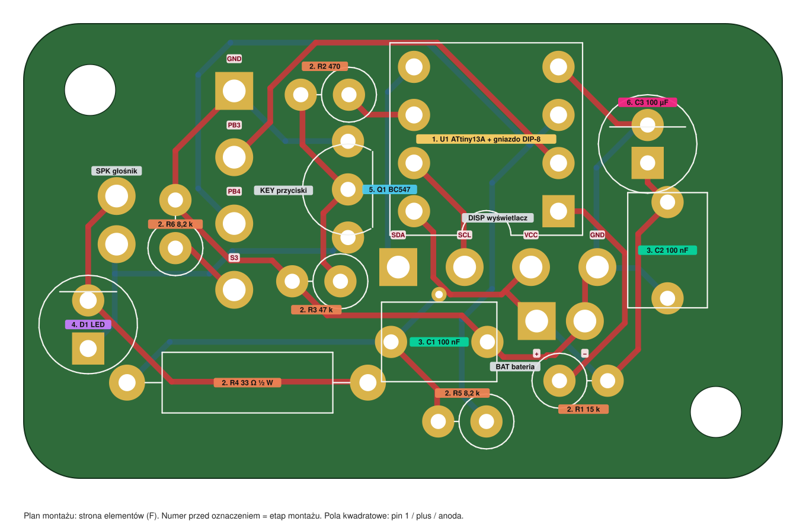

# Płytka główna: instrukcja montażu i kontrola

Płytka 40 × 24 mm do obudowy [klin 4](../obudowa-klin-4/README.md). Wszystkie elementy stoją na **stronie elementów (F)**, a lutujesz je od **strony lutowania (B)**, która w obudowie leży przy ściance pokrywy. Wszystkie pomiary robisz od strony lutowania: tam są wszystkie pola, a nazwy pól masz na [`plan-pomiarow.svg`](plan-pomiarow.svg). Rozmieszczenie elementów i oznaczenia: [`plan-montazu.svg`](plan-montazu.svg).

Kroki kontrolne oznaczone **KONTROLA** wykonuj po każdym etapie przed przejściem dalej. Kolumna „wynik” jest do uzupełnienia przez Ciebie. **Nie deklaruję, że coś działa, dopóki nie podasz wyniku** (jak w [testach odbiorczych](../testy-odbiorcze.md)).

## Lista części i narzędzi

Pełna lista: [`bom.csv`](bom.csv). Skrót:

| Oznaczenie | Element | Uwagi |
| --- | --- | --- |
| U1 | ATtiny13A-PU (DIP-8) + gniazdo DIP-8 | układ programujesz osobno, w gnieździe programatora |
| R1 | 15 kΩ (brązowy-zielony-pomarańczowy) | |
| R2 | 470 Ω (żółty-fioletowy-brązowy) | |
| R3 | 47 kΩ (żółty-fioletowy-pomarańczowy) | |
| R5, R6 | 8,2 kΩ (szary-czerwony-czerwony) | jednakowe |
| R4 | 33 Ω, ½ W (pomarańczowy-pomarańczowy-czarny) | leżący |
| C1, C2 | 100 nF | bez polaryzacji |
| C3 | 100 µF, min. 10 V, Ø5 mm | **polaryzacja**, wysokość do 8 mm |
| D1 | LED 5 mm | **polaryzacja** |
| Q1 | BC547 (A/B/C) | **orientacja** |
| przewody | 12 × linka 0,14 mm² w kolorach | DISP 4, KEY 4, BAT 2, SPK 2 |
| wkręty | 2 × M2,5 × 5 mm samogwintujące | nie dłuższe niż 5,6 mm |

Narzędzia: lutownica z grotem 1…2 mm, cyna 0,6…0,8 mm z topnikiem, szczypce tnące boczne, multimetr (ciągłość, Ω, V, najlepiej też µA i pojemność), suwmiarka lub linijka, szczypce do zagięć, pęseta.

**Zasady lutowania w tej obudowie:** po stronie lutowania (B) płytka ma do ścianki **2,5 mm**, więc po zalutowaniu **nic nie może wystawać więcej niż 2,0 mm nad laminat** (końcówka z cyną). Końcówki nóżek obetnij tuż nad lutem (zostaw ok. 1 mm), a lut niech będzie mały, stożkowy. Przewody lutujesz od strony elementów (F), końcówki po stronie B obetnij równo z cyną.

## Etap 0: odbiór gołej płytki

1. **Wizualnie:** zarys 40 × 24 mm z zaokrąglonymi narożnikami, dwa duże otwory M2,5 (Ø2,7), brak przerw w miedzi i zalań cyną między polami, kwadratowe pola (pin 1 U1, plus C3, anoda D1, BAT+, KEY1, DISP1).
2. **Wymiary:** suwmiarką 40,0 × 24,0 mm (±0,3), otwory M2,5 w (3,5; 20,5) i (36,5; 3,5) od lewego dolnego rogu w widoku od strony elementów.
3. **KONTROLA ciągłości (miernik na piszczenie, od strony lutowania):** wszystkie pola jednej sieci powinny ze sobą piszczeć. Pola wskazanych sieci **nie mogą** piszczeć z polami innej sieci.

| Sieć | Pola (oznaczenie.pin) |
| --- | --- |
| VCC | U1.8, R1.2, R4.2, R5.2, C1.2, C2.2, C3.+, DISP.3, BAT.1 |
| GND | U1.4, Q1.E, R3.2, R6.2, C1.1, C2.1, C3.−, DISP.4, BAT.2, KEY.1 |
| RESET | U1.1, R1.1 |
| PB3 | U1.2, KEY.2 |
| PB4 | U1.3, R5.1, KEY.3 |
| S3LOW | R6.1, KEY.4 |
| SDA | U1.5, DISP.1 |
| SCL | U1.7, DISP.2 |
| PB1 | U1.6, R2.1 |
| BASE | R2.2, Q1.B, R3.1 |
| COLL | Q1.C, SPK.2, D1.A |
| SPKR | SPK.1, D1.K, R4.1 |

Pary, które mają **nie** piszczeć (sprawdź przynajmniej te): VCC–GND, VCC–RESET, GND–PB3, GND–PB4, PB3–PB4, PB4–S3LOW, SDA–SCL, PB1–BASE, BASE–COLL, COLL–SPKR, RESET–PB3.

Wynik: ______ (jeśli którakolwiek para piszczy, nie montuj, tylko napisz, której)

## Etap 1: gniazdo U1

1. Gniazdo DIP-8 wkładasz **wcięciem do dołu planu** (strona pól DISP), czyli kwadratowy pin 1 jest w prawym dolnym rogu gniazda. Wcięcie jest narysowane w obrysie na płytce. Włóż, odwróć płytkę, dociśnij gniazdo do laminatu i zalutuj po jednym przeciwległym pinie (1 i 5), sprawdź prostopadłość, zalutuj resztę.
2. Obetnij piny po lutowaniu (max ok. 1 mm ponad lutem).

**KONTROLA:** nic nie może piszczeć między sąsiednimi pinami gniazda (1-2, 2-3, 3-4, 5-6, 6-7, 7-8) ani między 1-8, 4-5. Wynik: ______

## Etap 2: rezystory

Zmierz każdy rezystor przed włożeniem (tolerancja ±5%). Rezystory nie mają polaryzacji.

- **R4 (33 Ω, ½ W)** kładzie się poziomo w dolnej części płytki, na dwóch polach oddalonych o 12,7 mm (obrys prostokątny). Lutuj pierwszy, bo jest najniższy.
- **R1, R2, R3, R5, R6** **stoją**: korpus nad polem w kółku narysowanym na płytce, drugą nóżkę odegnij wzdłuż korpusu i włóż w sąsiednie pole. Wysokość do 7,5 mm.

| Oznaczenie | Wartość | Kolory | Odczyt |
| --- | --- | --- | --- |
| R1 | 15 kΩ | brązowy-zielony-pomarańczowy | ______ |
| R2 | 470 Ω | żółty-fioletowy-brązowy | ______ |
| R3 | 47 kΩ | żółty-fioletowy-pomarańczowy | ______ |
| R4 | 33 Ω | pomarańczowy-pomarańczowy-czarny | ______ |
| R5 | 8,2 kΩ | szary-czerwony-czerwony | ______ |
| R6 | 8,2 kΩ | szary-czerwony-czerwony | ______ |

**KONTROLA rezystancji** (multimetr Ω, od strony lutowania, jeszcze bez innych elementów). Punkty pomiarowe: VCC = BAT.1, GND = BAT.2, RESET = R1.1, PB4 = KEY.3, SPKR = R4.1, PB1 = R2.1, BASE = R3.1, S3LOW = KEY.4.

| Między | Spodziewany odczyt | Wynik |
| --- | --- | --- |
| VCC – RESET | 15 kΩ | ______ |
| VCC – PB4 | 8,2 kΩ | ______ |
| VCC – SPKR | 33 Ω | ______ |
| RESET – SPKR | 15 kΩ + 33 Ω = ok. 15,03 kΩ | ______ |
| PB4 – SPKR | 8,2 kΩ + 33 Ω = ok. 8,23 kΩ | ______ |
| PB1 – BASE | 470 Ω | ______ |
| BASE – GND | 47 kΩ | ______ |
| PB1 – GND | ok. 47,5 kΩ | ______ |
| S3LOW – GND | 8,2 kΩ | ______ |
| VCC – GND | **rozwarcie (OL)** | ______ |
| RESET – GND | **rozwarcie (OL)** | ______ |

Odczyt może się różnić o tolerancję rezystorów (±5%). Duże odchylenie oznacza zły rezystor w złym miejscu albo zimny lut.

## Etap 3: kondensatory C1 i C2

Włóż C1 i C2 (100 nF, bez polaryzacji, wysokość do 6 mm), zalutuj, obetnij.

**KONTROLA:** VCC–GND nadal bez zwarcia (odczyt rośnie do OL albo, na zakresie pojemności, **ok. 200 nF** dla C1 i C2 razem). Wynik: ______

## Etap 4: dioda D1 i tranzystor Q1

- **D1 (LED):** **kwadratowe pole = anoda = dłuższa nóżka.** Płaskie ścięcie obrysu LED jest po stronie katody (krótsza nóżka, okrągłe pole). Na planie anoda jest niżej, katoda wyżej.
- **Q1 (BC547):** **płaską stroną do prawej** (w stronę pól DISP i BAT). Wyprowadzenia od dołu planu ku górze: **C – B – E**. Nie dociskaj do laminatu na stałe: zostaw 1…2 mm nóżek, żeby nie przegrzać. Wysokość do 5,5 mm.

**KONTROLA (multimetr, funkcja testu diody; czerwona sonda +):**

| Czerwona sonda | Czarna sonda | Spodziewany odczyt | Wynik |
| --- | --- | --- | --- |
| Q1.B | Q1.E | 0,55…0,75 V | ______ |
| Q1.B | Q1.C | 0,55…0,75 V | ______ |
| Q1.E | Q1.B | OL | ______ |
| Q1.C | Q1.E | OL (w obie strony) | ______ |
| D1.A (anoda) | D1.K (katoda) | LED czerwona, żółta, zielona: 1,6…2,2 V. Niebieska i biała: OL (miernik daje za małe napięcie) | ______ |

(Odczyt B–E i B–C może być nieco niższy przez równoległe rezystory R3 i R2: to normalne.)

## Etap 5: kondensator C3 (polaryzacja!)

**Kwadratowe pole = plus.** Plus kondensatora to dłuższa nóżka, minus ma pasek na obudowie. Pasek ma być po stronie okrągłego pola (na planie górne). Odwrotne włożenie uszkadza kondensator.

**KONTROLA:** wysokość C3 nad laminatem **≤ 8 mm** (suwmiarka), VCC–GND bez zwarcia (na zakresie pojemności ok. 100 µF + 200 nF, odczyt wolno rośnie). Wynik: ______

## Etap 6: przewody

Zdejmij 2 mm izolacji, ocynuj, włóż od **strony elementów (F)** do pola, zalutuj od F, końcówkę po stronie B obetnij równo. Długości ustal po złożeniu pokrywy (ok. 50…70 mm, z luzem). Zapisz, który przewód jest którym polem.

| Grupa | Pole (od lewej do prawej / od góry do dołu na planie montażu) | Kolor (propozycja) |
| --- | --- | --- |
| **BAT** | BAT.1 (kwadratowe, **plus**), BAT.2 (minus) | czerwony, czarny |
| **SPK** | dwa pola po lewej stronie (bez polaryzacji) | dowolne |
| **KEY** (płytka przycisków) | od góry: KEY.1 (kwadratowe) GND, KEY.2 PB3, KEY.3 PB4, KEY.4 koniec S3 | czarny, pomarańczowy, niebieski, zielony |
| **DISP** (moduł OLED) | od lewej: DISP.1 (kwadratowe) SDA, DISP.2 SCL, DISP.3 VCC, DISP.4 GND | zielony, żółty, czerwony, czarny |

- **DISP:** moduły mają różną kolejność pinów VCC i GND. Łącz po **nazwie** sygnału z nadruku na module, a nie po kolejności pinów. Pull-upy SDA/SCL są w Twoim module, więc R7/R8 nie montujesz.
- **KEY:** kolory i numeracja odpowiadają przewodom z [płytki przycisków](../plytka-przyciskow/README.md): KEY1 GND, KEY2 PB3 („run”), KEY3 PB4, KEY4 (S3 „−” do R6).
- **BAT:** plus baterii do kwadratowego pola. Odwrotne podłączenie baterii może uszkodzić ATtiny, OLED i C3: sprawdź polaryzację multimetrem przed pierwszym podłączeniem.

**KONTROLA ciągłości (od końca przewodu do pola, miernik piszczy):**

| Koniec przewodu | Ma piszczeć z | Wynik |
| --- | --- | --- |
| BAT+ | U1.8 (VCC) | ______ |
| BAT− | U1.4 (GND) | ______ |
| SPK (jeden) | Q1.C | ______ |
| SPK (drugi) | R4.1 | ______ |
| KEY1 | U1.4 (GND) | ______ |
| KEY2 | U1.2 (PB3) | ______ |
| KEY3 | U1.3 (PB4) | ______ |
| KEY4 | R6.1 | ______ |
| DISP1 (SDA) | U1.5 | ______ |
| DISP2 (SCL) | U1.7 | ______ |
| DISP3 (VCC) | U1.8 | ______ |
| DISP4 (GND) | U1.4 | ______ |

Następnie powtórz test zwarć z Etapu 0 (VCC–GND itd.): **nic nie piszczy**.

## Etap 7: pierwsze zasilanie (bez ATtiny, bez modułu OLED, przyciski odłączone)

ATtiny13A **nie jest jeszcze włożony** do gniazda, moduł OLED i płytka przycisków jeszcze nie podłączone (KEY i DISP wiszą luźno). Podłącz koszyk 3×AAA (4,5…4,8 V) do przewodów BAT.

| Pomiar (napięcie względem GND) | Spodziewany wynik | Wynik |
| --- | --- | --- |
| U1.8 (VCC) | napięcie baterii (4,5…4,8 V) | ______ V |
| U1.1 (RESET) | = VCC (pull-up R1) | ______ V |
| U1.3 (PB4) | = VCC (pull-up R5) | ______ V |
| Q1.B | ok. 0 V (R3 ściąga do GND) | ______ V |
| Q1.C | ≈ VCC (brak prądu przez głośnik) | ______ V |
| Prąd z baterii (amperomierz w szereg z jednym przewodem BAT) | poniżej 20 µA po ok. minucie (ładowanie C3 mija) | ______ µA |

Test tranzystora i głośnika: **na 1…2 sekundy** zewrzyj U1.6 (PB1) z U1.8 (VCC) kawałkiem przewodu. Głośnik ma **kliknąć**, a LED na chwilę słabo mignąć. Nie trzymaj dłużej: R4 grzeje się (ok. 0,4 W przy 100 mA). Wynik: ______

**Jeśli którykolwiek pomiar się nie zgadza:** odłącz baterię, wróć do Etapów 1…6. Gorący element lub zapach: natychmiast odłącz baterię i sprawdź polaryzację C3 oraz zwarcia.

## Etap 8: przyciski, wyświetlacz i ATtiny

1. **Przyciski** (płytka przycisków podłączona do KEY, bateria podłączona, ATtiny nadal wyjęty): mierz **U1.3 (PB4)** względem GND. Bez naciskania: = VCC. „+” (S2): ok. 0 V. „−” (S3): ok. połowy VCC (R5 = R6). Przycisk „run” (S1): odłącz baterię i miernikiem na ciągłość sprawdź, że **U1.2 (PB3)–GND piszczy tylko po wciśnięciu**. Wyniki: ______ / ______ / ______ / ______
2. **Wyświetlacz:** podłącz moduł do DISP wg nazw sygnałów. Przy baterii: między VCC a GND modułu napięcie baterii, a SDA i SCL względem GND ≈ VCC (pull-upy modułu). Wynik: ______
3. **ATtiny:** zaprogramuj **poza płytką** wg [programowanie.md](../programowanie.md) i skalibruj wg [kalibracja.md](../kalibracja.md). Odłącz baterię, włóż układ do gniazda **wcięciem (kropką) do dołu planu**, pin 1 przy kwadratowym polu (prawy dolny róg gniazda). Nóżki wchodzą bez siły: wyprostuj je, jeśli nie.
4. Włącz baterię: ekran ma pokazać **2:00 w ciągu 1 s**. Dalsze testy: [testy-odbiorcze.md](../testy-odbiorcze.md), testy 1…9 (pobór w uśpieniu: test 8).

W razie problemów: [diagnostyka.md](../diagnostyka.md) (wspólna z płytką stykową: odczyt sygnatury, pusty OLED, brak dźwięku, przyciski reagują losowo).

## Etap 9: montaż w obudowie

1. Sprawdź wysokości po stronie lutowania: nic wyżej niż **2,0 mm** nad laminat. Sprawdź wysokości od strony elementów (limity z obudowy): U1 w gnieździe 8,5, D1 8,7, C3 8,0, rezystory stojące 7,5, C1 i C2 6,0, Q1 5,5 mm.
2. Płytkę przykręć **dwoma wkrętami M2,5 × 5 mm od strony elementów** do słupków w pokrywie (strona lutowania do ścianki). Wkręt nie dłuższy niż 5,6 mm: słupek ma otwór 4,1 mm, a za nim ścianka 0,5 mm.
3. Przewody poprowadź według [README obudowy klin 4](../obudowa-klin-4/README.md) (punkt „Do uzupełnienia i ryzyka”, pozycja 3): BAT od styków koszyka, SPK do głośnika, KEY do płytki przycisków, DISP do modułu; pamiętaj o odciążeniu (opaska, kropla kleju).
4. Zamknij obudowę i wykonaj [testy odbiorcze](../testy-odbiorcze.md).

## Gdy coś nie działa (skrót)

| Objaw | Co sprawdzić |
| --- | --- |
| Para pól piszczy, a nie powinna | zwarcie cyną między polami; obejrzyj lupą od strony B |
| VCC–GND piszczy | zwarcie, odwrócony C3, zwarty lut przy pinach U1 |
| Pusty OLED | kolejność VCC/GND modułu (po nazwach), pull-upy, adres 0x3C |
| Brak dźwięku | Q1 odwrócony (płaska strona do prawej), D1 odwrócona, R2/R3 na złych polach |
| Przyciski losowo | KEY3 (PB4) i R5/R6 (po 8,2 kΩ, jednakowe), zimne luty na przyciskach |
| Reset przy dźwięku | C3 odwrócony lub zimny lut, bateria rozładowana |
