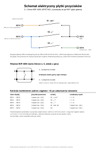

# Płytka przycisków na płytce uniwersalnej (obudowa klin 4)

Trzy przyciski Omron B3F-4055 (S3 „−”, S1 „run”, S2 „+”) na kawałku jednostronnej płytki uniwersalnej **50 × 16 mm**, z czterema przewodami do pól KEY płytki głównej. Zarys, otwory M2 i rozstaw przycisków są zgodne z [obudową klin 4](../obudowa-klin-4/README.md#5-płytka-przycisków-na-płytce-uniwersalnej) (dane: [`pcb-layout.json`](../pcb-klin3/pcb-layout.json), klucz `button_board`).

**Do druku: [`plytka-przyciskow-szablon.pdf`](plytka-przyciskow-szablon.pdf)** (A4, 4 strony):

| Strona | Treść |
| --- | --- |
| 1 | **Szablon 1:1** od strony elementów: zarys z narożnikami R2, siatka oczek, otwory M2 Ø2,2, obrysy przycisków, tabela współrzędnych, linijka kontrolna 100 mm |
| 2 | **Połączenia** od strony lutowania w skali 3:1: adresy oczek, 6 przewodów rozdzielczych, 4 pola KEY, lista przewodów z kolorami i długościami |
| 3 | **Schemat elektryczny**, wnętrze przycisku wg karty, kontrola multimetrem |
| 4 | Lista części i narzędzi, kolejność montażu, najczęstsze pułapki |

Te same strony jako SVG: `plytka-przyciskow-{szablon,polaczenia,schemat,montaz}.svg`. Generator i kontrola projektu: [`tools/pcb/button_board.py`](../../tools/pcb/button_board.py).

```bash
python3 tools/pcb/button_board.py           # kontrola + PDF/SVG w tym katalogu (wymaga rsvg-convert)
python3 tools/pcb/button_board.py --check   # tylko kontrola
```

## Założenie: przycisk zgodny z kartą

Projekt przyjmuje budowę z karty Omron B3F (A070-E1-08, s. 6, model B3F-4055 „projected plunger, bez nóżki masy”):

| Co | Wartość z karty |
| --- | --- |
| Połączenia wewnętrzne (widok z góry) | **4–3 i 2–1 połączone na stałe**, wciśnięcie zwiera górny rząd z dolnym |
| Nóżki | 4 szt., **12,5 × 5,0 mm** (±0,1), otwory w płytce Ø1,2 (±0,05); blaszki ok. 1,0 × 0,3 mm (odczyt z rysunku), 3,5 mm pod korpusem |
| Kołki ustalające | 2 szt. Ø1,6 (otwory Ø1,8), **9,0 mm** od siebie, na osi między kolumnami nóżek |
| Korpus, wysokość, trzpień | 12 × 12 mm, 7,3 mm nad płytką (korpus 4,3), trzpień 3,8 × 3,8 mm |
| Siła, skok | 2,55 ±0,69 N, skok 0,3 mm; obciążenie 1…50 mA, 3…24 V; mycie niemożliwe |

To rozstrzyga sprzeczność z wcześniejszej specyfikacji (`docs/pcb/specyfikacja-obudowy-dla-agenta.md`, punkt 7: „wg pomiaru właściciela 5 mm”): **nóżki połączone na stałe dzieli 12,5 mm**, nie 5 mm. Numery nóżek nie są nadrukowane na obudowie przycisku, więc w projekcie rozróżnia się je po położeniu: para nóżek rozstawionych o 12,5 mm to jeden „rząd”.

Skoro założenie decyduje o schemacie, pierwszym krokiem montażu jest **sprawdzenie ciągłości na samych przyciskach** (strona 3 i 4 PDF). Jeśli wynik wyjdzie odwrotnie, nie lutuj dalej.

## Płytka uniwersalna

- Jednostronna FR4 **1,6 mm**, raster **2,54 mm**, **osobne pola lutownicze** (nie płytka paskowa: paski zwarłyby nóżki). Kawałek co najmniej 55 × 20 mm, wygodniej 70 × 30 mm.
- Przed zakupem lub użyciem sprawdź raster: skrajne oczka rzędu na płytce mają trafić w kropki A i T szablonu (19 odstępów = 48,26 mm). Płytki o rastrze 2,5 mm się nie nadają.
- Oczka Ø1,0 mogą być za ciasne dla blaszki 1,0 × 0,3 mm (przekątna ok. 1,05 mm): jeśli nóżka wchodzi z oporem, rozwierć oczko pod nóżkę do Ø1,2, zgodnie z kartą.

## Geometria i raster

Siatka oczek leży tak, że wszystkie nóżki przycisków trafiają w oczka. Adres oczka to **kolumna A…T + rząd 1…7** w widoku od strony elementów (x w prawo, y w górę), jak na szablonie.

| Element | Położenie [mm] od lewego dolnego narożnika | Oczko |
| --- | --- | --- |
| przycisk S3 „−” (środek) | 7,22; 8,00 | nóżki A3, F3 (dół), A5, F5 (góra) |
| przycisk S1 „run” | 25,00; 8,00 | H3, M3, H5, M5 |
| przycisk S2 „+” | 42,78; 8,00 | O3, T3, O5, T5 |
| otwór M2-1 Ø2,2 | 16,11; 2,92 | G2 |
| otwór M2-2 Ø2,2 | 33,89; 13,08 | N6 |

- Pierwsze oczko (A1) jest w (0,87; 0,38), ostatnie (T7) w (49,13; 15,62). Raster ma 20 kolumn × 7 rzędów, a środki przycisków leżą w połowie oczka (x) i na rzędzie 4 (y).
- Rozstaw oczek 12,70 mm kontra 12,50 mm w karcie: oczka są o 0,10 mm na każdą stronę dalej niż otwory zalecane, w granicach tolerancji karty (nóżki są sprężyste). Odchyłka w osi y to 0,04 mm. Generator sprawdza to przy każdym uruchomieniu.
- **Skrajne rzędy oczek (1 i 7) leżą 0,38 mm od krawędzi, więc linia cięcia przetnie ich oczka.** Nie są używane. Nie da się tego uniknąć bez zmiany obudowy: rzędy nóżek (y = 5,46 i 10,54) wyznaczają fazę rastra. Skrajne kolumny (A i T) są 0,87 mm od krawędzi i zostają prawie całe.
- Dwa otwory M2 leżą na oczkach, po przekątnej, pomiędzy przyciskami (słupki w pokrywie nie wchodzą w korpusy: sprawdzone wymiarowo).

## Schemat



| Przycisk | Górny rząd (nóżki 4–3) | Dolny rząd (nóżki 2–1) | Zwiera |
| --- | --- | --- | --- |
| S1 „run” | KEY1 (GND) | KEY2 (PB3) | KEY1–KEY2 |
| S2 „+” | KEY1 (GND) | KEY3 (PB4) | KEY1–KEY3 |
| S3 „−” | KEY4 (do R6, potem GND) | KEY3 (PB4) | KEY3–KEY4 |

Zgodne z [`docs/schemat.md`](../schemat.md): PB3 ma wewnętrzny pull-up, PB4 ma R5 8,2 kΩ do VCC, a „−” przechodzi przez R6 8,2 kΩ do GND (R6 jest na płytce głównej). Kontrola w generatorze buduje sieć z rysunku (nóżki, przewody, wewnętrzne połączenia przycisku) i sprawdza wszystkie 8 kombinacji wciśniętych przycisków: puszczone dają cztery osobne pola, a każdy przycisk zwiera dokładnie swoją parę. Wykrywa to błędy typu przewód na złym rzędzie albo pole KEY w złym oczku (sprawdziłem na celowo zepsutych wariantach).

## Połączenia na płytce

Wszystko po stronie lutowania, widok na stronie 2 PDF (obrócony jak kartka wokół osi pionowej, więc kolumny idą T → A).

| Nr | Od | Do | Sieć | Kolor | Trasa |
| --- | --- | --- | --- | --- | --- |
| W1 | M5 (S1, nóżka 3) | N4 | GND | czarny | 3,6 mm |
| W2 | O5 (S2, nóżka 4) | N4 | GND | czarny | 3,6 mm |
| W3 | M3 (S1, nóżka 1) | N2 | PB3 | pomarańczowy | 3,6 mm |
| W4 | F3 (S3, nóżka 1) | G4 | PB4 | niebieski | 3,6 mm |
| W5 | O3 (S2, nóżka 2) | G4 | PB4 | niebieski | 22,9 mm, rowkiem między rzędami 3 i 4 |
| W6 | F5 (S3, nóżka 3) | G6 | KEY4 | zielony | 3,6 mm |
| KEY1 | N4 | płytka główna | GND | czarny | |
| KEY2 | N2 | płytka główna | PB3 | pomarańczowy | |
| KEY3 | G4 | płytka główna | PB4 | niebieski | |
| KEY4 | G6 | płytka główna | do R6 | zielony | |

- Pola przewodu leżą w dwóch kolumnach między przyciskami (G i N), poza korpusami, więc przewód można przewlec z oczka na stronę elementów. Dwa przewody idą do jednej kolumny, dwa do drugiej: kabel z płytki głównej wystarczy rozdzielić na pary.
- Pozostałe nóżki (np. H5, T3) są po prostu przylutowane: wewnętrzne połączenie przycisku łączy je z sąsiadką.
- Oczka N4 i G4 mają po trzy przewody (kabel + dwa rozdzielcze): użyj cienkich przewodów rozdzielczych Ø0,25 (wire-wrap AWG30).
- Przewód W5 biegnie 3,8 mm od osi wkręta M2 w G2 (łeb Ø4 ma promień 2 mm). Generator pilnuje, żeby trasy przewodów były co najmniej 2,3 mm, a używane oczka co najmniej 3,4 mm od osi M2.
- Kolory kabla do płytki głównej to propozycja. Ważne, żeby zapisać, który przewód jest którym polem KEY.

## Instrukcja montażu

**Części:** 3 × Omron B3F-4055 (nie B3F-4155: ma piątą nóżkę), płytka uniwersalna jak wyżej, 6 przewodów rozdzielczych w izolacji Ø0,25 (razem ok. 10 cm), 4 linki 0,14 mm² w kolorach z tabeli, 2 wkręty samogwintujące M2 × 6, cyna z topnikiem bezmyjnym. **Narzędzia:** wiertła Ø1,0 i Ø2,2 (opcjonalnie Ø1,2), imadło, piła do laminatu lub miniszlifierka, pilnik, nożyk, szczypce tnące, multimetr, lutownica z grotem 1…2 mm.

0. **Sprawdź przyciski** (przed czymkolwiek). Multimetrem w zakresie ciągłości: nóżki rozstawione o 12,5 mm w jednym rzędzie (4–3 oraz 2–1) mają ciągłość zawsze, a nóżki w tej samej kolumnie (4–2, 3–1; 5,0 mm) tylko po wciśnięciu. Jeśli jest odwrotnie, przycisk nie jest zgodny z kartą: zatrzymaj się i zmierz sześć par nóżek.
1. **Wydrukuj stronę 1 w skali 100 %** (w oknie drukowania „Rzeczywisty rozmiar”, bez „Dopasuj do strony”). Odcinek 100 mm i kwadrat 20 × 20 mm sprawdź linijką. Dokładność wydruku nie ma tu znaczenia dla oczek (te są na płytce), ale ma dla linii cięcia i otworów M2.
2. **Przyłóż szablon do płytki** tak, by kropki szablonu (także szare, poza zarysem) pokryły się z oczkami płytki; zamocuj kawałkiem taśmy lub klejem w sztyfcie. Środki M2 nakłuj igłą przez papier (krzyżyki wskazują środek), zdejmij szablon. Linię cięcia możesz odrysować rysikiem.
3. **Wywierć M2:** płytka w imadle na drewnianej podkładce, najpierw Ø1,0, potem Ø2,2 (otwór ma być 2,2, bo wkręt idzie przez niego do słupka pokrywy). Rób to przed cięciem, kiedy płytka jest jeszcze duża.
4. **Wytnij zarys** 50 × 16 mm (zostaw 0,2 mm na pilnik), opiłuj do linii, zaokrąglij narożniki R2, usuń zadziory pilnikiem lub papierem. Dopuszczalna odchyłka wymiaru ok. ±0,3 mm (kapsle mają w otworach pokrywy 0,3 mm luzu, a płytka trzyma się na słupkach, więc ważniejsze od zarysu jest położenie M2 i przycisków). Pył z laminatu: maska i przewiew.
5. **Kołki ustalające przycisków** odetnij nożykiem lub szczypcami równo z korpusem (od spodu). To zalecany wariant: kołki nie trafiają w oczka (leżą 0,58 mm od rzędu oczek), a cztery luty trzymają przycisk w zupełności. Alternatywa: wywierć Ø1,8 według tabeli na stronie 1 (zniszczy to też brzegi sąsiednich oczek, które i tak nie są używane).
6. **Przymierz nóżki** przycisków w oczkach (bez lutowania). Nóżki są sprężyste i lekko zbiegają się (12,5 mm kontra 12,7 mm oczek), ale powinny wejść bez wciskania na siłę. Jeśli nie: rozwierć oczka pod nóżki Ø1,2.
7. **Włóż trzy przyciski** od strony elementów, korpusem do laminatu, bokami równolegle do krawędzi płytki (dłuższy rozstaw nóżek 12,5 mm wzdłuż płytki). Zalutuj po jednej nóżce, sprawdź, czy korpus leży płasko i prosto (ew. przegrzej i popraw), dopiero potem pozostałe, razem 12 lutów. Lutuj krótko, kilka sekund na nóżkę. **Nie myj** płytki z przyciskami (karta: mycie niemożliwe), resztki topnika bezmyjnego zostaw.
8. **Przewody rozdzielcze W1…W6** wg tabeli: zdejmij 1,5 mm izolacji, przewlecz lub przyłóż końcówkę do pola, zalutuj. Przewód układaj płasko przy laminacie (po stronie lutowania wystają końcówki nóżek do 1,9 mm: przewody nie powinny sięgać wyżej niż one) i z dala od czerwonych okręgów M2 (łeb wkręta).
9. **Cztery przewody do płytki głównej** (KEY1…KEY4) wlutuj w pola N4, N2, G4, G6 (przewód od strony lutowania przez oczko, końcówka po stronie elementów max 1 mm i utnij ją równo z laminatem; nad płytką od tej strony jest 6,8 mm do sufitu pokrywy). Długość: do ustalenia po złożeniu pokrywy (przewody od strony lutowania zbieraj ku płytce głównej, z luzem 10…15 mm).
10. **Kontrola multimetrem** (strona 3): puszczone: wszystkie pary KEY rozwarte; S1 zwiera KEY1–KEY2, S2 zwiera KEY1–KEY3, S3 zwiera KEY3–KEY4, a przy żadnym z nich nie ma innych zwarć.
11. **Montaż w pokrywie:** płytkę dołóż od wnętrza do słupków i przykręć dwoma wkrętami M2 × 6 od strony lutowania (łeb wkręta nie może leżeć na lutach ani przewodach). Na trzpienie przycisków wciśnij kapsle. Przycisk powinien dać wyraźne „kliknięcie” przez kapsel.

## Zgodność z obudową

- Trzpienie 7,3 mm nad płytką, kapsle i gniazda są z [klina 4](../obudowa-klin-4/README.md#4-kapsle-przycisków-b3f-4055); płytka trzyma się na słupkach z otworem Ø1,7 (pod M2 × 6).
- Płytka jest elementami do pokrywy, lutami do wnętrza. Ta strona jest w obudowie widoczna na renderze `12-pokrywa-od-srodka.png`: otwory M2 są na nim w lewym górnym i prawym dolnym rogu, co zgadza się z odbiciem na stronie 2 PDF (M2-2 po lewej u góry, M2-1 po prawej na dole).
- Oś x płytki jest osią obudowy: lewa krawędź (x = 0) jest od strony głośnika. Przycisk „−” (S3) jest przy głośniku, „+” (S2) przy prawym boku. Obrócenie płytki o 180° zamieni przyciski miejscami względem kapsli.

## Czego nie sprawdziłem i ryzyka

1. **Prawdziwe części.** Wszystko wynika z karty i z modelu obudowy, nic nie jest zmierzone na fizycznym B3F-4055 ani na konkretnej płytce uniwersalnej. Krok 0 i przymiarka (krok 6) są po to, żeby to wyłapać zanim cokolwiek zalutujesz.
2. **Karta nie podaje warunków lutowania** (w pliku jest tylko „mycie niemożliwe”): lutuj krótko i bez przegrzewania. Parametry ogólne Omron dla przełączników dotykowych leżą w osobnym dokumencie „Safety Precautions”, którego nie sprawdzałem.
3. **Skrajne rzędy oczek** są przecięte linią cięcia (punkt wyżej): to wynika z geometrii obudowy i nie wpływa na działanie. Jeśli zależy Ci na czystym brzegu, trzeba by zmienić rozstaw przycisków albo wymiar obudowy.
4. **Przewody i luz w pokrywie:** wysokość lutów i przewodów po stronie lutowania nie była sprawdzana modelem 3D (przyjęto do 1,9 mm jak dla nóżek).
5. **Płytka główna** nie jest częścią tej paczki i nadal nie ma plików produkcyjnych (zob. [`docs/pcb-klin3/README.md`](../pcb-klin3/README.md): trasowanie jest próbą wykonalności, a nie ostatecznym projektem miedzi).
